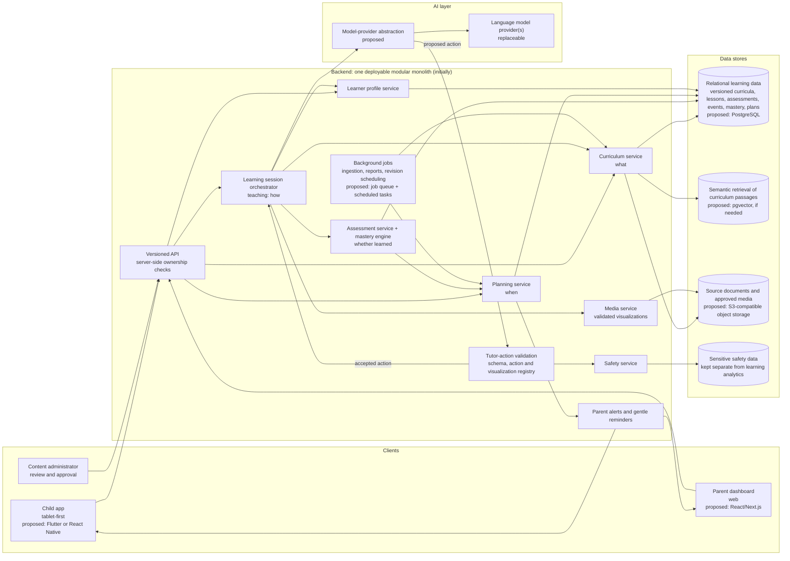
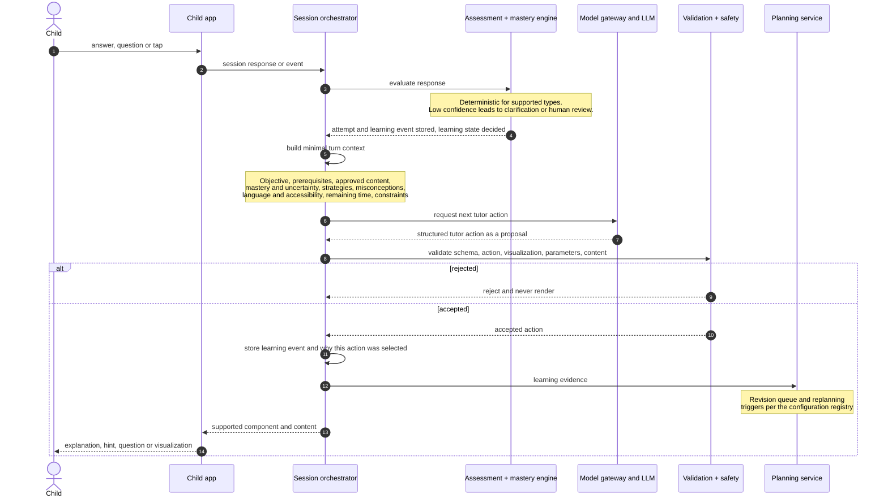
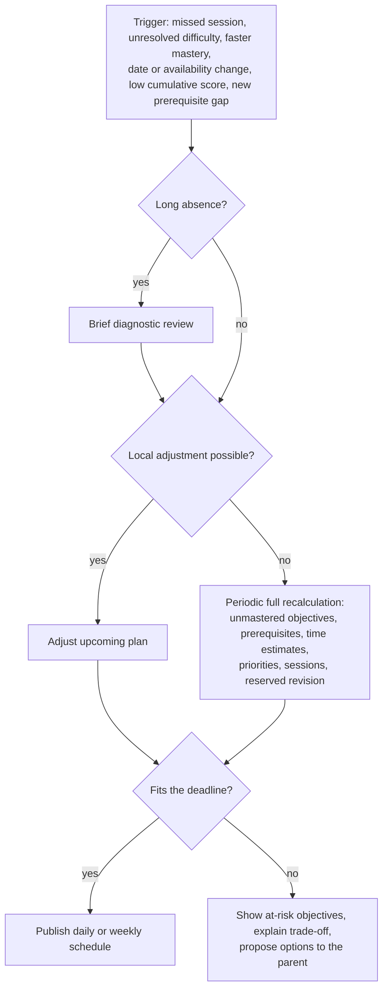

# Learning Companion — one-page spec and architecture

> **Vision:** a learning companion that turns a child's syllabus into a
> personalized journey of discovery, adapts to how they understand concepts,
> keeps their learning on track, and helps them discover what they love and what
> they might become good at. ([idea](./idea.md))

Quick overview of the [spec](./spec/README.md) and [plan](./plan/README.md).
Proposals are labelled *proposed*; nothing here is a confirmed stack or threshold.

## Problem, users, success

- **Problem:** the same material at the same pace for every child; "taught",
  "answered correctly once" and "remembered later" are treated as the same thing,
  and a missed week is "handled" by moving faster.
- **For:** the **child** (primary user, tablet), the **parent** (configures goals,
  schedule and permissions; reviews progress) and the **content administrator**
  (approves curriculum, generated material and questions).
- **Success:** a child finishes a diagnostic and a lesson, returns after an
  interruption and continues without losing confirmed progress; independent
  assessment and delayed recall separate exposure from lasting understanding.
- **Success:** a parent sees curriculum gaps, deadline risk and actionable next
  steps; teaching changes are judged by independent understanding, not screen time.

## Core capabilities

Four engines with separate authority ([why](./plan/design-notes.md#why-this-is-not-just-a-chatbot)),
backed by the [core modules](./spec/system.md#core-modules):

| Engine / module | Responsibility | Canonical spec |
| --- | --- | --- |
| **Curriculum** — curriculum service | Decides **what** to learn: versioned objectives with stable IDs, prerequisites, traceable sources | [learner-and-curriculum.md](./spec/learner-and-curriculum.md) |
| **Adaptive teaching** — learning session orchestrator, learner profile service | Decides **how** to teach: strategies, adaptation rules, Engagement-to-Mastery, visuals, voice | [teaching.md](./spec/teaching.md) |
| **Assessment** — assessment service (mastery engine) | Decides **whether it was learned**: validated questions, deterministic grading, learning states, revision | [assessment.md](./spec/assessment.md) |
| **Planning** — planning service | Decides **when**: dependency-aware schedule, feasibility, replanning, missed sessions | [planning.md](./spec/planning.md) |
| **Parent insights** | Calm, actionable dashboard and alerts; evidence-based, revisable interest observations | [parent-insights.md](./spec/parent-insights.md) |
| **Safety & privacy** — safety service | Age-appropriate interaction, consent, minimization, deletion, responsible inference | [safety.md](./spec/safety.md) |
| **Media**, data model, APIs | Validated reusable visualizations; durable relational entities; versioned, ownership-checked APIs | [system.md](./spec/system.md) |

## Core learning loop

From the [end-to-end journey](./spec/learner-and-curriculum.md#43-end-to-end-user-journey):

1. Parent sets up the learner: grade, board, language, available time, goals, target date.
2. Approved sources become a versioned curriculum of objectives and prerequisites.
3. A short adaptive diagnostic establishes the baseline (with confidence).
4. The planner builds a dependency-aware plan with practice and revision time.
5. The child learns through stories, visuals, questions and explanation.
6. Knowledge checks, independent problems and later recall measure understanding.
7. Teaching, pace and upcoming lessons adapt; the plan is updated when needed.
8. The parent sees progress, unresolved gaps, emerging interests and next steps.

## Key rules and guardrails

| Rule | In one line | Home |
| --- | --- | --- |
| Deterministic authority | Application logic owns curriculum completeness, deadlines, session state, supported grading, mastery decisions, revision scheduling, permissions and safety | [system.md §6.1](./spec/system.md#61-separate-deterministic-logic-from-generative-logic) |
| Model only proposes | Structured tutor actions only; invalid actions, unknown visualizations, unsupported parameters and unsafe content are rejected; no arbitrary code or UI | [system.md](./spec/system.md#api-and-model-output-requirements), [draft protocol](./plan/draft-contracts.md#62-use-a-structured-tutor-action-protocol) |
| Minimal context | Each turn gets only relevant context, never the child's entire history | [system.md](./spec/system.md#api-and-model-output-requirements) |
| Mastery ≠ exposure | One learning-state vocabulary; watching a lesson never marks a concept mastered | [learning states](./spec/learner-and-curriculum.md#coverage-versus-mastery) |
| Honest feasibility | Infeasible plans are flagged with options; essential concepts are never silently skipped | [planning.md](./spec/planning.md#example-the-six-month-recovery-scenario) |
| Child safety & privacy | Educational boundaries, no guilt/fear/streak-loss pressure, parental consent, minimization, deletion, safety data kept separate | [safety.md](./spec/safety.md), [sessions](./spec/teaching.md#414-child-friendly-experience-and-gamification), [system.md §5.4](./spec/system.md#54-core-data-model) |
| No aptitude labels | Qualitative evidence with confidence; no career predictions, "visual learner" labels or sibling ranking | [safety.md §7.4](./spec/safety.md#74-prevent-false-aptitude-judgments), [guardrails](./spec/parent-insights.md#guardrails) |
| Tunable values | Session length, replanning trigger, revision intervals, progression criteria: never hard-code from this page | [configuration registry](./spec/README.md#configuration-registry), [starting assumptions](./plan/design-notes.md#tunable-starting-assumptions) |

## Architecture

**One deployable backend initially**: a modular monolith with separated domain
modules and one orchestrator — not microservices or autonomous multi-agent
systems; split only when scale or team boundaries justify it
([architecture plan](./plan/architecture.md)). Technology names below are
*proposed* alternatives from the [proposed stack](./plan/architecture.md#52-recommended-technology-stack),
pending the M1 stack decision.

**One tutoring turn** (illustrative; assembled from the
[domain contract](./spec/system.md#api-and-model-output-requirements) — wire
schemas are [drafts](./plan/draft-contracts.md), not frozen):

Handling after a rejected action is not yet specified; it belongs to the
M1 contracts decision below.

**Replanning loop** (from [planning.md](./spec/planning.md#replanning-triggers)):

## Roadmap at a glance

Durations are indicative; details in the [roadmap](./plan/roadmap.md).

- **M1 — Working prototype (POC):** one complete journey for one grade and
  subject — learner profile, curated curriculum, diagnostic, basic plan,
  interactive AI lesson, feedback, saved progress, parent view. **Exit:** a child
  resumes after closing the app, and the system distinguishes a lesson viewed
  from a concept demonstrated. No career profiling or elaborate gamification.
  [First demonstrable experience](./plan/roadmap.md#the-first-demonstrable-experience).
- **M2 — Adaptive learning MVP:** concept-level mastery, multiple strategies,
  validated question banks, spaced revision, parent dashboard, replanning.
- **M3 — Visual and engaging learning:** reusable visualizations, stories,
  puzzles, narration and speech input.
- **M4 — Full curriculum management:** automated ingestion, curriculum
  versioning, more subjects, feasibility analysis, exam simulation.
- **M5 — Long-term learner development:** evidence-based interest profiles,
  enrichment and longitudinal progress.

## Open decisions

**11** open decisions in the [registry](./spec/README.md#open-decisions);
**7 block M1**: launch board/grade/subject/lesson set · first-release source
types · client/backend/provider/deployment stack · progression, confidence and
recall criteria · frozen API, error, idempotency and tutor-action schemas ·
consent, retention/deletion and safety-escalation procedures · offline cache
and sync semantics.

---

*Summary only — the `spec/` files are normative; on conflict, spec wins.* Read
next: [project README](./README.md#reading-order-for-an-agent) →
[spec reading order](./spec/README.md#reading-order) →
[plan](./plan/README.md#reading-order).
